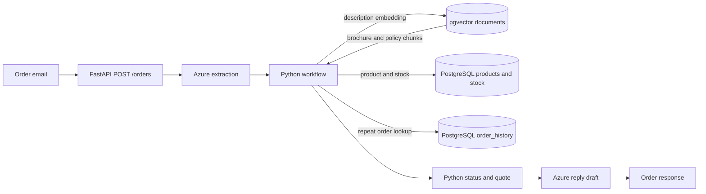

# Starter Project 2 — Architecture Design Notes

## Purpose

The order desk accepts a customer's email, extracts the requested details, checks the product catalogue and current stock, and returns a computed status, quote, and draft reply. Python remains authoritative for validation, stock, status, and pricing. The language model extracts or explains information but does not decide availability or quote values.

## Request workflow

1. FastAPI accepts an email at `POST /orders`; the email parser reads its headers, body, and date.
2. Azure OpenAI extracts the customer, city, deadline, items, quantities, description indicators, and repeat-order intent into a Pydantic model. The prompt treats the email as untrusted data.
3. The query is embedded with the configured Azure embedding deployment. `DocumentRepository` retrieves the nearest brochure or pricing-policy chunks from PostgreSQL/pgvector.
4. When an item is a product description, the resolver sees only retrieved brochure candidates. Python accepts a returned code only if it was in those candidates, then looks the code up in the product table. An unresolved or ambiguous item needs customer clarification.
5. For repeat orders, `ProductRepository` reads the customer's most recent order date and its order lines from `order_history`.
6. Python validates required values and lead time, reads current stock and unit prices, decides Ready/Partial/Need info, and builds a quote using the configured discount tiers and `Decimal` arithmetic. A quote is omitted when information is still needed.
7. Azure OpenAI drafts a reply from the computed result and retrieved context. It does not receive the raw email and cannot change the computed status or quote.

## Document ingestion

`scripts/ingest_documents.py` reads markdown beneath `data/starter-project-2/docs`, splits it at headings, embeds each section, and upserts chunks by `(source, heading)`. This makes re-ingestion safe to repeat. The document table stores source, heading, content, and a 1536-dimensional vector. Similarity search uses cosine distance and a small top-k result set.

## Data stores

- `products`: product code, canonical name, category, and unit price in INR.
- `stock`: available quantity, joined to products by product code. The workflow only reads stock.
- `order_history`: historical customer order lines used for repeat-order references.
- `documents`: brochure and policy sections with embeddings for retrieval.

The Starter Project 2 SQL is additive and idempotent. For an existing PostgreSQL volume, apply `data/starter-project-2/sp2_seed.sql`; do not delete the volume to initialize S2. Fresh databases run the S1 seed before the S2 seed through Compose.

## Decision and quote rules

- Need info takes priority when required details are missing/invalid, the product is unknown or ambiguous, or the deadline is too soon.
- Partial applies when the request is valid but one or more quantities exceed available stock.
- Ready applies when the details are valid and requested quantities are in stock.
- The quote includes only quantities currently available. Discounts are applied per product line using quote quantity. The delivery charge is applied to the discounted subtotal threshold. Quote validity is based on the customer's email date.
- All quote calculations use `Decimal` and round line totals to two decimal places.

## Configuration and security

Runtime configuration is read from `.env`; `.env.example` contains placeholders. Azure chat and embedding deployments and the PostgreSQL URL must be configured before live requests. Secrets must not be committed. SQL values are parameterized, and product codes selected by the resolver are checked against retrieved candidates before database lookup.

## Components

- FastAPI and Pydantic: API contract and structured data models.
- `AzureLLMClient`: structured extraction, embeddings, constrained product resolution, reply drafting, retries, latency/token logs.
- `DocumentRepository`: vector chunk upsert and cosine-similarity retrieval.
- `ProductRepository`: catalogue, stock, and latest-order history lookups.
- `OrderWorkflow`: orchestration, Python validation, status decision, and quote calculation.
- pytest and evaluation scripts: offline regression tests and live dataset scoring.
